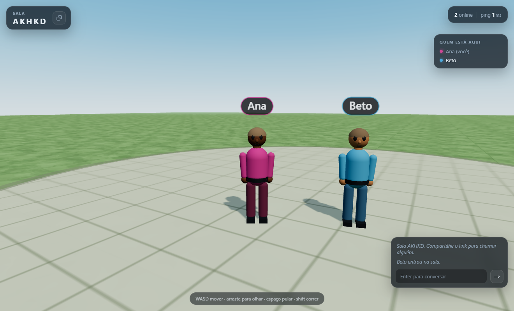

# Passear

Um mundo 3D plano e multiplayer, direto entre navegadores. Você cria uma sala,
manda o código (ou o link) para alguém e os dois aparecem no mesmo gramado como
bonecos 3D que andam, pulam, conversam por chat, andam de carro e caem no chão
com física de ragdoll.

**Jogue agora:** <https://cakesweet.github.io/passear/>

- **Three.js** desenha o mundo e os bonecos.
- **PeerJS / WebRTC** conecta os navegadores em malha (P2P). Não existe servidor
  de jogo: cada participante manda a própria posição para os outros.
- **Zero build**: são arquivos estáticos + um servidorzinho de desenvolvimento
  em Node, sem dependências.



## Como rodar

Precisa de Node 18+ só para servir os arquivos (o jogo em si roda no navegador).

```bash
npm start
```

Abra <http://localhost:5173>. Para jogar com alguém na mesma rede, use o
endereço `http://SEU-IP:5173` que o terminal mostra ao iniciar.

> Abrir `index.html` com dois cliques **não funciona**: módulos ES precisam de
> HTTP. Use o servidor acima (ou `npx serve`, ou qualquer hospedagem estática).

### Jogar sozinho para testar

1. Clique em **Criar sala**. Um código de 5 letras aparece no topo.
2. Abra outra aba, cole o código no campo e clique em **Entrar**.
3. Ande com **WASD** em uma aba e veja o outro boneco se mover na outra.

### Controles

| Ação | Tecla |
| --- | --- |
| Andar | `W` `A` `S` `D` ou setas |
| Correr | `Shift` |
| Pular | `Espaço` |
| Entrar / sair do carro | `E` (perto do carro) |
| Dirigir | `W` acelera, `S` freia/dá ré, `A` `D` viram |
| Cair / levantar | `R` |
| Olhar | arrastar com o mouse (ou um dedo no celular) |
| Zoom | roda do mouse / pinça |
| Conversar | `Enter` (e `Esc` para sair do chat) |

No celular aparecem um direcional virtual, um botão de pulo e um botão de ação
(entrar/sair do carro ou levantar), que muda conforme o contexto.

O carro tem **quatro lugares** — o banco do motorista e mais três. Quem senta no
banco do motorista dirige; os passageiros andam junto. Quem chega primeiro pega
o banco livre de menor número. Carros em movimento derrubam quem está no caminho
(ragdoll automático).

## Como a conexão funciona

```
        sinalização (só para se encontrarem)
     A  ───────────────►  0.peerjs.com  ◄───────────────  B
     │                                                    │
     └──────────────── WebRTC (dados) ───────────────────┘
```

1. Quem cria a sala registra um ID fixo e previsível no servidor PeerJS:
   `passear-v1-room-<codigo>`.
2. Quem entra conecta nesse ID. O anfitrião responde com a lista de quem já está
   lá e avisa todo mundo que chegou gente nova.
3. A partir daí cada par abre a **sua própria** conexão. O anfitrião deixa de
   participar: posições e chat vão direto de um navegador para o outro.
4. Para dois jogadores não abrirem conexão um com o outro ao mesmo tempo, vale
   a regra **quem tem o ID lexicograficamente menor disca**. A conexão com o
   anfitrião é sempre mantida, porque é a porta de entrada da sala.

Consequências:

- Até ~8 pessoas por sala vai bem (cada um mantém N−1 conexões).
- Se o anfitrião sair, a sala continua funcionando para quem já está dentro, mas
  ninguém novo consegue entrar (o código fica sem "porteiro"). O app avisa.
- Redes muito restritivas (NAT simétrico, algumas redes corporativas) podem
  bloquear o P2P. Aí é preciso um servidor **TURN** — veja abaixo.

## Configuração

Tudo em [`js/config.js`](js/config.js):

| Campo | Para que serve |
| --- | --- |
| `peer.config.iceServers` | STUN/TURN usados na conexão. Adicione um TURN aqui se o P2P falhar em redes fechadas. |
| `peer.host` / `port` / `secure` | Troque do servidor público do PeerJS para um seu. |
| `net.stateHz` | Frequência de envio da posição (15 Hz por padrão). |
| `world.bounds` | Raio do gramado onde dá para andar. |
| `move.*` | Velocidade de caminhada/corrida, pulo, gravidade, aceleração. |
| `car.spawn` | Onde o carro nasce (mesma pose para todos ao entrar). |
| `car.maxSpeed` / `accel` / `brake` / `turnRate` | Direção arcade: velocidade, aceleração, freio e velocidade de curva. |
| `car.enterRadius` | Distância para conseguir entrar no carro. |
| `ragdoll.syncHz` | Frequência com que o dono manda as posições do ragdoll. |
| `ragdoll.maxMs` / `minMs` | Tempo máximo caído e tempo mínimo antes de poder levantar. |

### Servidor de sinalização próprio

```bash
npx peerjs --port 9000 --path /myapp
```

```js
// js/config.js
peer: {
  host: 'localhost',
  port: 9000,
  path: '/myapp',
  secure: false,
  config: { iceServers: [...] },
}
```

### TURN (quando o P2P não conecta)

```js
config: {
  iceServers: [
    { urls: 'stun:stun.l.google.com:19302' },
    {
      urls: 'turn:turn.seudominio.com:3478',
      username: 'usuario',
      credential: 'senha',
    },
  ],
}
```

## Estrutura

```
index.html        tela inicial, HUD e chat
style.css         visual dos painéis, menu e controles de toque
server.mjs        servidor estático de desenvolvimento (sem dependências)
js/main.js        liga tudo: cena, loop, entrada na sala, loop de rede
js/world.js       céu em gradiente, luz com sombra, gramado plano e praça
js/avatar.js      boneco low-poly com andar/correr/pular/sentado e etiqueta
js/player.js      controle e física do jogador local (relativo à câmera)
js/car.js         buggy aberto de 4 lugares, direção arcade e colisão
js/ragdoll.js     ragdoll de Verlet (13 pontos, restrições de distância) + rede
js/camera.js      câmera em terceira pessoa com órbita amortecida
js/network.js     malha P2P com PeerJS (sala, hello/welcome, estado, carro, ragdoll, chat, ping)
js/input.js       teclado + joystick virtual
js/ui.js          menu, placar, chat, toasts, copiar convite
js/utils.js       cores por nome, ângulos, códigos de sala
```

### Protocolo (DataChannel, JSON)

| Mensagem | Conteúdo | Quando |
| --- | --- | --- |
| `hello` | nome, cor, posição, banco | ao abrir qualquer conexão |
| `welcome` | lista de participantes + estado do mundo (carro) | anfitrião → recém-chegado |
| `peer-join` | perfil de quem chegou | anfitrião → todos |
| `st` | `p` posição, `r` rotação, `s` velocidade, `a` no ar, `k` banco | 15×/s para cada par |
| `car` | `x`, `z`, `yaw`, `v` velocidade, `st` volante | só o motorista, 20×/s |
| `rag` | `p` lista de 13 pontos (ou `null` ao levantar) | dono do ragdoll, 12×/s |
| `chat` | nome, cor, texto | ao enviar |
| `ping` / `pong` | timestamp | a cada 2,5 s |
| `bye` | — | ao sair |

O boneco remoto é interpolado entre as posições recebidas, então mesmo com
15 mensagens por segundo o movimento fica suave.

**Autoridade:** cada jogador manda a própria posição. O carro só é simulado por
quem está no banco do motorista (os outros perseguem a pose recebida), e cada
ragdoll é simulado por quem caiu (os outros reproduzem os pontos). O ocupante de
cada banco é deduzido do campo `k` que cada jogador manda — não existe um dono
central da sala.

Para evitar conflito de banco, cada jogador escolhe o primeiro banco livre que
conhece. Dois cliques simultâneos no mesmo banco são raros e se resolvem quando
alguém sai; não há validação por servidor.

## Depurar

Abra com `?debug=1` e use `window.__passear` no console:

```js
__passear.remotes        // bonecos remotos, posição-alvo, velocidade, banco, ragdoll
__passear.net.peers      // conexões abertas
__passear.me.player.pos  // sua posição
__passear.car            // pose/velocidade do carro
__passear.seat           // seu banco (-1 = a pé)
__passear.ragdoll        // seu ragdoll quando está caído
__passear.rig            // yaw, pitch, distância da câmera
```

## Publicar

Versão no ar: **<https://cakesweet.github.io/passear/>** (branch `main`, raiz do
repositório, sem build).

Qualquer hospedagem estática com HTTPS também serve (Netlify, Vercel, Cloudflare
Pages). Basta subir `index.html`, `style.css` e a pasta `js/`. O `server.mjs` é
só para desenvolvimento local.

Para publicar no GitHub Pages a partir do zero:

```bash
git init -b main
git add -A
git commit -m "mundo 3D P2P"
gh repo create passear --public --source=. --push
gh api -X POST repos/{owner}/passear/pages \
  -f 'source[branch]=main' -f 'source[path]=/'
```

O `.nojekyll` já está no repositório para o Pages servir os arquivos como estão.

## Limites conhecidos

- Sem autoridade de servidor: posições são confiadas aos clientes (tudo bem para
  um passeio, não para competição).
- Sem persistência: sala, chat e mundo existem só enquanto as abas estão abertas.
- Sem áudio por voz (dá para adicionar com `peer.call` + `getUserMedia`).
- O ID de quem cria a sala é fixo por código; se a aba fechar de repente, o mesmo
  código pode ficar "preso" por alguns segundos no servidor de sinalização.
